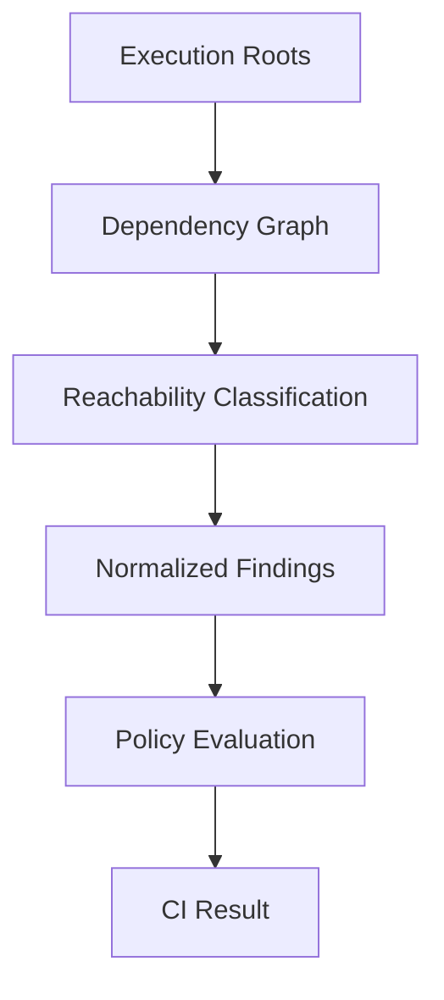
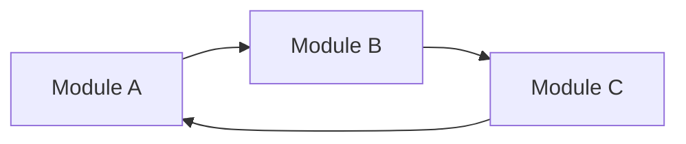
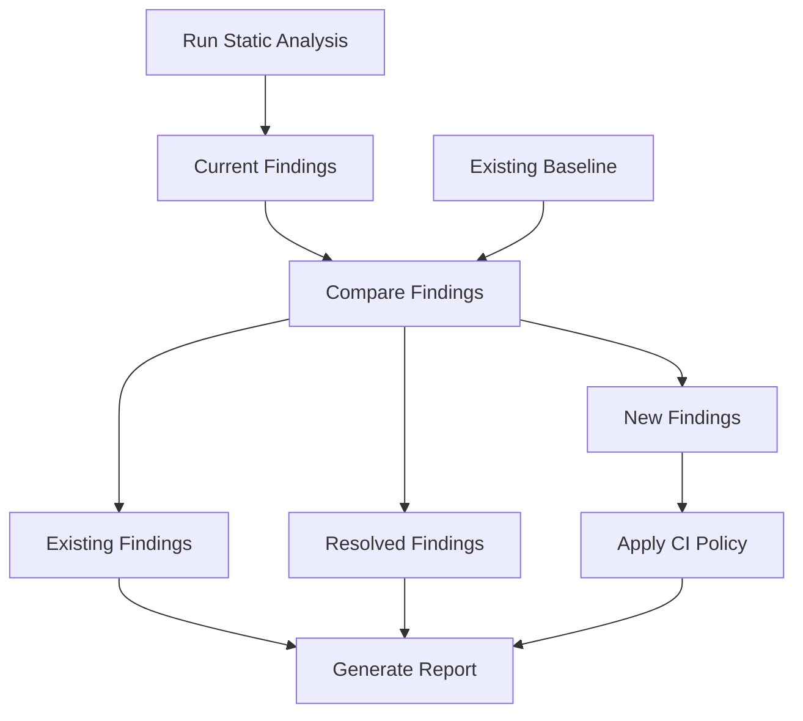
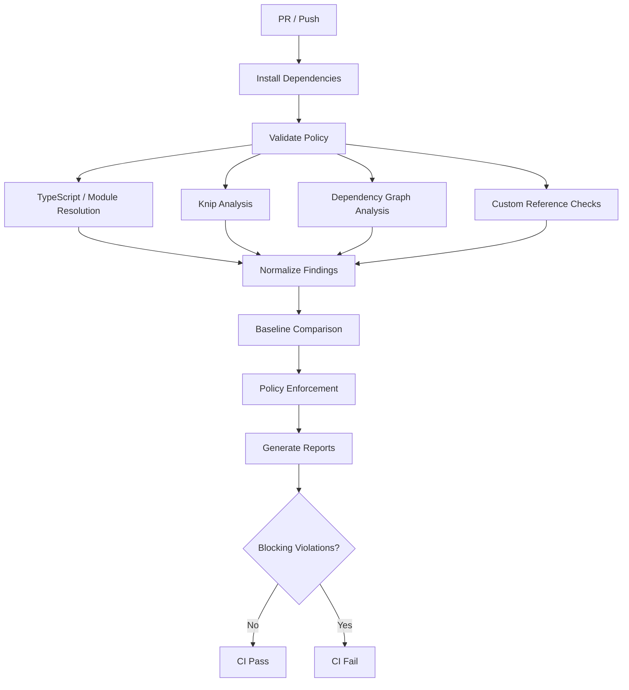

# Specification: CI Code Reference Integrity & Dead Code Detection

> Requirements as supplied by the user on 2026-10-18, kept verbatim as the
> source cited by `2026-10-18-fleet-standards-design.md` ("the requirements").
> Where the two disagree, the design records the decision and why.

**Target:** Base / Template Repository  
**Type:** CI Quality Gate / Architectural Governance  
**Status:** Proposed  
**Priority:** Medium–High  
**Implementation approach:** Incremental, baseline-aware, configuration-driven  
**Primary languages:** TypeScript / JavaScript  
**Optional extensions:** PHP, WordPress, JSON, YAML, shell scripts

## 1. Executive Summary

Implement an automated CI system that analyzes repository dependencies, source-code references, and runtime reachability to identify unused code, broken references, orphaned files, and architectural violations.

The system must distinguish between **code that is not statically referenced** and **code that cannot be reached through any recognized execution path**.

The objective is to reduce technical debt, prevent architectural drift, identify dead code, and ensure repository integrity without introducing excessive false positives or disrupting existing development workflows.

The implementation should be reusable across repositories created from the base template.

### Primary objectives

1. Detect broken imports and missing referenced files.
2. Identify unused files, exports, and dependencies.
3. Identify code unreachable from recognized execution entry points.
4. Detect circular dependencies and prohibited dependency relationships.
5. Account for dynamically loaded modules and framework-specific registration patterns.
6. Establish baseline-aware CI enforcement.
7. Produce actionable, evidence-based diagnostic reports.
8. Support configurable policies across different repository types.
9. Enable architectural validation without coupling enforcement to a specific application.
10. Never automatically delete source code.

---

## 2. Architectural Principles

### 2.1 Detection must be evidence-based

Every finding should identify:

- What was detected.
- Why it was flagged.
- Which analysis produced the finding.
- The relevant source file and symbol, where available.
- The confidence level.
- Recommended remediation.

### 2.2 Avoid reinventing static analysis

Use established analyzers for language-specific analysis.

| Component | Responsibility |
|---|---|
| TypeScript compiler | Type checking and module resolution |
| ESLint | Local unused variables and related code-quality checks |
| Knip | Unused files, exports, dependencies, and declarations |
| dependency-cruiser | Dependency graphs, cycles, and architectural boundaries |
| Custom policy layer | Repository-specific rules and classifications |
| Custom reporting layer | Normalize findings, manage baselines, and generate reports |
| PHPStan (optional) | PHP static analysis |
| WordPress-aware extension (optional) | Hook and runtime registration validation |

The custom implementation should primarily coordinate tools, interpret results, and enforce policy.

### 2.3 Separate observation from enforcement

The system must support three operating modes.

| Mode | Behavior |
|---|---|
| Observe | Generate reports without affecting CI status |
| Ratchet | Enforce policies against new findings relative to a baseline |
| Strict | Enforce all findings designated as blocking |

New repositories should be able to start in Strict mode.

Existing repositories should initially use Observe or Ratchet mode.

### 2.4 Treat uncertain reachability as uncertain

Static analysis cannot reliably prove that all dynamically loaded code is unused.

The system must distinguish:

- Confirmed broken references.
- Confirmed unused declarations within supported analysis boundaries.
- Potentially unreachable code.
- Unresolved dynamic references.
- Explicitly retained code.

Uncertainty must not automatically be interpreted as dead code.

---

# 3. Functional Requirements

## FR-001: Import and Reference Integrity

**Priority:** P0  
**Default severity:** Error

The system must detect imports and references that point to missing or invalid targets.

### Detection scope

- TypeScript imports.
- JavaScript imports.
- CommonJS `require()` references.
- Static dynamic-import expressions.
- TypeScript path aliases.
- Package exports.
- Local module references.
- Configured manifest file paths.
- Supported asset references.

### Example

```typescript
import { Config } from './config/missing-file';
```

Expected output:

```text
ERROR REF-001

File: src/bootstrap.ts
Line: 12

Unresolved module:
./config/missing-file

Resolution:
No matching module found under active TypeScript
module-resolution configuration.

Action:
Correct the import or restore the target module.
```

### Acceptance criteria

- Missing static imports are detected.
- Valid path aliases are resolved.
- Type-only imports are supported.
- Missing package dependencies are detected.
- TypeScript project references are respected.
- Explicitly configured asset references are validated.
- Non-applicable references are not treated as errors.

**Important:** The checker must respect the repository's actual compiler, bundler, and runtime resolution rules. A generic filesystem existence check is insufficient.

---

## FR-002: Unused Source Files

**Priority:** P1  
**Default severity:** Warning

Identify source files that have no recognized usage.

### Analysis

For each source file, determine:

1. Whether it is a configured execution entry point.
2. Whether another file imports or references it.
3. Whether it is referenced through a recognized registry.
4. Whether it is referenced by supported configuration.
5. Whether it is excluded from analysis.
6. Whether it is reachable from an execution root.

### Classification

| Classification | Description |
|---|---|
| Reachable | Connected to a recognized execution entry point |
| Orphaned | No recognized inbound references |
| Disconnected | Referenced by other files but not reachable from any execution root |
| Dynamic | Potentially loaded through runtime mechanisms |
| Retained | Explicitly designated as intentionally retained |
| Unknown | Analyzer cannot establish reachability |

A file can be disconnected without being orphaned.

This distinction is mandatory.

---

## FR-003: Unused Exports

**Priority:** P1  
**Default severity:** Warning

Detect exported declarations without known consumers.

Supported declarations should include functions, classes, constants, types, interfaces, and re-exports where supported by the analyzer.

### Example

```typescript
export function calculateLegacyScore() {
  return 42;
}
```

If no recognized consumer exists:

```text
WARNING DEAD-002

Unused export detected.

Symbol: calculateLegacyScore
File: src/utils/scoring.ts

Known consumers: 0
```

### Special considerations

Exports used through package public APIs must not be classified as dead merely because no consumer exists inside the repository.

This is especially important for reusable template packages, libraries, and independently published modules.

The analyzer must understand declared package entry points and public exports.

---

## FR-004: Unused Dependencies

**Priority:** P1  
**Default severity:** Warning

Detect dependencies declared in package manifests that are not referenced by recognized source files, configurations, scripts, or supported plugins.

### Categories

- Unused production dependencies.
- Unused development dependencies.
- Unlisted dependencies.
- Unresolved dependencies.

### Enforcement

Unlisted dependencies used by source code should be eligible for blocking enforcement.

Unused dependencies should initially generate warnings.

The system must account for tools invoked through package scripts and runtime configuration rather than source imports.

---

## FR-005: Runtime Reachability Analysis

**Priority:** P1  
**Default severity:** Warning

Build a dependency graph to establish which modules can be reached from recognized execution entry points.

### Conceptual model



### Execution roots

Potential execution roots include:

- Application bootstrap files.
- Package entry points.
- CLI executables.
- Test entry points.
- Worker entry points.
- Background job entry points.
- Framework-recognized routes.
- Registered plugins.
- Explicitly configured runtime modules.

Tests should generally be analyzed separately from production reachability.

A production module used only by tests is not necessarily part of the production application.

### Acceptance criteria

- Reachability is evaluated from configured roots.
- Disconnected dependency islands are identified.
- Production and test reachability can be differentiated.
- Public library entry points are respected.
- Unknown dynamic references are reported without automatically declaring their targets dead.

---

# 4. Dynamic Reference Awareness

**Priority:** P1

Dynamic module loading is the largest source of false positives.

Examples include:

```typescript
await import(`./modules/${name}.js`);
```

```typescript
registry.register('analytics', analyticsModule);
```

```php
add_action('init', [FeatureBootstrap::class, 'register']);
```

The system should support a layered resolution strategy.

### Layer 1: Static analysis

Use ordinary import and dependency analysis.

### Layer 2: Framework conventions

Recognize entry points defined by supported frameworks and build tools.

### Layer 3: Explicit registrations

Use a policy manifest to identify runtime registrations that cannot be established statically.

### Layer 4: Unknown classification

Mark unresolved dynamic relationships for review.

Do not silently declare all files matching a broad dynamic-import pattern reachable.

### Policy configuration

Proposed location:

```text
.config/code-integrity/policy.yaml
```

Example:

```yaml
schemaVersion: 1

analysis:
  languages:
    - typescript
    - javascript

entrypoints:
  production:
    - src/index.ts
    - src/cli/**/*.ts
    - src/workers/**/*.ts

  tests:
    - tests/**/*.test.ts

dynamicReferences:
  - id: feature-registry
    type: registry
    registry: src/core/feature-registry.ts
    targets:
      - src/features/**/*.ts
    behavior: review

exclusions:
  - path: "**/*.generated.ts"
    reason: Generated source

  - path: "**/vendor/**"
    reason: External dependencies
```

These paths are examples. The actual configuration should be derived from each consuming repository.

The configuration schema must be validated before analysis.

---

# 5. Circular Dependency Detection

**Priority:** P1  
**Default severity:** Warning

Detect circular module dependencies.

Example:



The system should report:

- Modules participating in the cycle.
- The complete dependency path.
- Whether the cycle involves production code.
- Whether the cycle crosses package boundaries.
- Whether the cycle violates an explicit architecture rule.

Not every circular dependency must fail CI.

However, cycles that violate declared architectural boundaries should be eligible for blocking enforcement.

---

# 6. Architectural Boundary Enforcement

**Priority:** P2

This capability extends the system beyond conventional dead-code detection.

Repositories should optionally declare permitted dependency relationships.

Example:

```yaml
boundaries:
  - id: prohibit-private-package-imports
    severity: error
    rule:
      from: "packages/*/src/**"
      disallow:
        - "packages/*/src/internal/**"

  - id: prohibit-legacy-imports
    severity: error
    rule:
      disallow:
        - "src/legacy/**"
```

The exact schema should be designed around the capabilities of the selected dependency analyzer.

### Potential architectural checks

| Rule | Description |
|---|---|
| Package encapsulation | Prevent imports into another package's private implementation |
| Layering | Enforce direction of dependencies between architectural layers |
| Legacy isolation | Prevent new imports from retired modules |
| Dependency cycles | Prohibit cycles across defined boundaries |
| Public API usage | Require consumers to use public package entry points |
| Registration integrity | Verify declared components have valid registration targets |

The base template should provide the framework and example rules, not impose outerReach-specific architectural assumptions.

---

# 7. Finding Classification and Confidence

**Priority:** P1

All findings must use a normalized schema.

### Proposed finding structure

```typescript
interface IntegrityFinding {
  id: string;
  ruleId: string;

  severity: 'error' | 'warning' | 'info';

  confidence: 'high' | 'medium' | 'low';

  classification:
    | 'broken-reference'
    | 'orphaned-file'
    | 'disconnected-file'
    | 'unused-export'
    | 'unused-dependency'
    | 'unlisted-dependency'
    | 'circular-dependency'
    | 'architecture-violation'
    | 'unknown-dynamic-reference';

  file: string;
  line?: number;
  column?: number;
  symbol?: string;

  message: string;
  evidence: string[];

  remediation?: string;
  analyzer: string;
}
```

The implementation should additionally support stable finding fingerprints, tool versions, rule versions, and structured metadata needed for baseline comparisons.

### Confidence guidance

| Confidence | Interpretation |
|---|---|
| High | Direct evidence supports the finding |
| Medium | Strong static evidence, but runtime usage is not fully established |
| Low | Potential problem requiring manual investigation |

Confidence and severity are separate concepts.

A high-confidence unused export may still be a warning.

A high-confidence broken import may be an error.

---

# 8. Baseline-Aware Enforcement

**Priority:** P0

The system must support existing repositories without requiring immediate remediation of all historical findings.

### Baseline location

```text
.config/code-integrity/baseline.json
```

### Example

```json
{
  "schemaVersion": 1,
  "generatedAt": "2026-10-18T00:00:00Z",
  "findings": [
    {
      "fingerprint": "example-stable-fingerprint",
      "ruleId": "DEAD-002",
      "file": "src/legacy/scoring.ts",
      "symbol": "calculateLegacyScore"
    }
  ]
}
```

### Comparison logic



### Enforcement requirements

- New blocking findings fail CI.
- Existing baseline findings do not automatically fail CI in Ratchet mode.
- Resolved findings are identified.
- Newly introduced warnings are visible.
- Baseline updates require an explicit developer action.
- The baseline must not be silently regenerated during CI.
- Changed findings must not be accidentally suppressed due to unstable fingerprints.

Baseline entries should ideally be matched using normalized paths, rule identifiers, symbols, and relevant semantic identity rather than line numbers alone.

### Important safeguard

An existing baseline entry must not allow a new severe defect to hide behind an old finding.

The system should support rules that always block, regardless of baseline status.

Broken imports are a strong candidate.

---

# 9. Suppressions and Intentional Retention

**Priority:** P1

The system must provide a controlled mechanism for suppressing valid findings.

Example:

```yaml
suppressions:
  - rule: DEAD-001
    target: src/compatibility/legacy-adapter.ts
    reason: Required for compatibility with older integrations
    owner: platform
    expires: 2027-01-01
```

### Requirements

Every suppression must include:

- Rule identifier.
- Target.
- Rationale.
- Owner.
- Optional expiration date.

I recommend making expiration mandatory for new suppressions, with an explicit permanent-retention classification where justified.

### Validation

CI must detect:

- Invalid suppression targets.
- Unknown rule identifiers.
- Expired suppressions.
- Duplicate suppressions.
- Suppressions that no longer match any finding.

Stale suppressions should generate warnings so that exceptions don't accumulate indefinitely.

---

# 10. Reporting

**Priority:** P1

The system should produce both human-readable and machine-readable reports.

### Required outputs

```text
artifacts/
└── code-integrity/
    ├── report.json
    ├── summary.md
    └── findings.sarif
```

These are generated CI artifacts, not necessarily files committed to the repository.

### GitHub Actions integration

Use:

- GitHub Actions job summaries.
- Pull request annotations where supported.
- Uploaded analysis artifacts.
- SARIF integration with GitHub code scanning when repository permissions and available features permit.

### Example summary

```text
Code Integrity Analysis

Files analyzed:              1,284
Modules analyzed:            1,106
Execution roots:                24

Broken references:               0
Unused files:                   17
Disconnected files:              4
Unused exports:                 38
Unused dependencies:             3
Circular dependencies:           2

New blocking findings:           0
New warnings:                    2
Resolved findings:               5

Result: PASS
```

These numbers are illustrative.

### Evidence reporting

Each finding should explain why it exists.

For unreachable files, include:

- Recognized incoming references.
- Reachability from production roots.
- Reachability from test roots.
- Relevant dynamic registrations.
- Exemptions and suppressions.
- Analysis limitations.

This should make findings investigable without requiring developers to reverse-engineer the analyzer.

---

# 11. CI Integration

**Priority:** P0

### Proposed pipeline



### Proposed workflow

```text
.github/workflows/code-integrity.yml
```

Recommended triggers:

- Pull requests targeting protected branches.
- Pushes to the primary branch.
- Manual dispatch for full repository scans.

### Execution strategy

Initially, run the complete analysis on every pull request.

Introduce incremental analysis only if measured execution times justify the additional complexity.

Incremental graph analysis is more complicated than checking modified files because changes can affect the reachability of otherwise untouched modules.

### Failure handling

Distinguish analysis failure from detected code violations.

| Situation | Result |
|---|---|
| Analyzer execution fails | CI failure |
| Policy configuration invalid | CI failure |
| Broken import detected | CI failure |
| New prohibited dependency detected | CI failure |
| New unused export | Warning initially |
| Existing baseline finding | No additional failure in Ratchet mode |
| Unknown dynamic reference | Review finding |
| Report generation fails | CI failure if required reporting is unavailable |

Analyzer crashes must never be interpreted as a clean result.

---

# 12. Proposed Repository Structure

The base/template repository should own the configuration, integration scripts, and reusable reporting logic.

```text
repository/
│
├── .github/
│   └── workflows/
│       └── code-integrity.yml
│
├── .config/
│   └── code-integrity/
│       ├── policy.yaml
│       ├── baseline.json
│       └── suppressions.yaml
│
├── scripts/
│   └── code-integrity/
│       ├── index.ts
│       ├── config.ts
│       ├── normalize.ts
│       ├── baseline.ts
│       ├── policy.ts
│       ├── report.ts
│       └── checks/
│           └── references.ts
│
├── tests/
│   └── code-integrity/
│       ├── fixtures/
│       ├── config.test.ts
│       ├── baseline.test.ts
│       ├── policy.test.ts
│       └── reporting.test.ts
│
├── knip.config.ts
├── .dependency-cruiser.cjs
└── package.json
```

The exact structure should align with the template's existing conventions.

### Design consideration

If this capability is intended for repeated use across many independent repositories, I would eventually extract the orchestration layer into its own versioned package or reusable GitHub Action.

The template would then consume that implementation and provide repository-specific policies.

That prevents fixes to the analysis system from requiring manual replication across every descendant repository.

---

# 13. Implementation Plan

## Phase 1 — Foundation and Tool Integration

**Priority:** P0

### Tasks

1. Audit existing repository tooling and CI conventions.
2. Identify source languages and package boundaries.
3. Establish production and test entry points.
4. Install and configure Knip.
5. Install and configure dependency-cruiser.
6. Reuse existing TypeScript and ESLint checks.
7. Create the initial policy configuration.
8. Create the GitHub Actions workflow.
9. Run initial analysis in Observe mode.

### Deliverables

- Functional static analysis.
- Validated analyzer configuration.
- Initial dependency graph.
- Baseline report.
- Non-blocking CI integration.

### Exit criteria

All configured analyzers execute successfully and produce reproducible findings.

---

## Phase 2 — Normalized Findings and Policy Engine

**Priority:** P0

### Tasks

1. Define normalized finding schema.
2. Implement analyzer output adapters.
3. Implement policy evaluation.
4. Implement deterministic finding fingerprints.
5. Implement baseline generation and comparison.
6. Implement suppression handling.
7. Implement CI exit-code enforcement.
8. Add structured logging and failure diagnostics.

### Deliverables

- Unified finding format.
- Configurable severity model.
- Baseline-aware enforcement.
- Controlled suppressions.
- Ratchet-mode CI quality gate.

### Exit criteria

New blocking findings fail CI while existing baseline findings remain tracked without blocking under Ratchet mode.

---

## Phase 3 — Reachability and Dynamic References

**Priority:** P1

### Tasks

1. Establish recognized production roots.
2. Establish test-only roots.
3. Integrate reachability classifications from dependency analysis.
4. Identify disconnected dependency islands.
5. Support configured runtime registration patterns.
6. Add unknown-dynamic-reference classifications.
7. Define intentional-retention rules.
8. Validate false-positive behavior against representative fixtures.

### Deliverables

- Production reachability analysis.
- Orphan/disconnected file classification.
- Dynamic reference policy support.
- Improved confidence classification.

### Exit criteria

Legitimate dynamically loaded modules are not incorrectly classified as confirmed dead code, while demonstrably disconnected code is still reported.

---

## Phase 4 — Architectural Governance

**Priority:** P2

### Tasks

1. Define package boundary rules.
2. Define optional layer dependency rules.
3. Implement public API boundary checks.
4. Implement legacy dependency prohibitions.
5. Configure circular dependency policies.
6. Add architecture-specific findings.
7. Add policy validation tests.

### Deliverables

- Configurable architecture rules.
- Dependency boundary enforcement.
- Cross-package violation detection.

### Exit criteria

Deliberate architecture violations are detected and correctly classified according to configured policy.

---

## Phase 5 — Reporting and Developer Experience

**Priority:** P1

### Tasks

1. Generate Markdown summaries.
2. Generate normalized JSON reports.
3. Generate SARIF output.
4. Add GitHub Actions annotations.
5. Upload reports as CI artifacts.
6. Document common findings and remediation.
7. Add local commands for analysis and baseline review.
8. Provide a method to explain file reachability.

### Suggested commands

```bash
npm run integrity:check
npm run integrity:report
npm run integrity:baseline
npm run integrity:explain -- src/example.ts
```

These are proposed command interfaces, not existing commands.

### Exit criteria

Developers can identify, investigate, and resolve findings without manually correlating multiple analyzer outputs.

---

## Phase 6 — Hardening and Template Reusability

**Priority:** P2

### Tasks

1. Create integration fixtures for supported repository layouts.
2. Test monorepo and single-package configurations.
3. Test public library entry points.
4. Test dynamic imports.
5. Test generated code exclusions.
6. Test baseline changes and suppression expiration.
7. Validate behavior on clean and intentionally broken repositories.
8. Document template adoption requirements.
9. Establish versioning and upgrade strategy.

### Exit criteria

The system operates consistently across representative repositories with minimal project-specific implementation changes.

---

# 14. Validation and Test Requirements

The implementation must include automated tests demonstrating both detection capability and false-positive resistance.

| Test case | Expected result |
|---|---|
| Valid import | Pass |
| Missing import | Error |
| Valid TypeScript alias | Pass |
| Invalid alias target | Error |
| Unused local export | Warning |
| Public package export | No incorrect unused finding |
| Completely orphaned source file | Warning |
| Disconnected module island | Warning |
| Registered dynamic module | No confirmed-dead classification |
| Unknown dynamic import | Review |
| Valid generated file exclusion | Pass |
| Circular dependency | Warning or error by policy |
| Prohibited cross-package import | Error |
| Existing baseline violation | Tracked, non-blocking in Ratchet mode |
| New blocking violation | Fail |
| Resolved baseline violation | Report as resolved |
| Expired suppression | Policy violation |
| Invalid configuration | Fail |
| Analyzer crash | Fail |
| Missing report artifact | Fail when reporting is required |

Additional tests should cover Windows versus POSIX paths, file renames, package exports, test-only references, and deterministic fingerprint generation.

---

# 15. Nonfunctional Requirements

### Performance

The system should execute within a defined CI performance budget.

A reasonable initial engineering target is to keep the analysis job below three minutes for a typical template-derived repository, excluding dependency installation.

This is a target, not a guaranteed runtime.

### Determinism

Equivalent repository states must produce equivalent normalized findings.

### Maintainability

Prefer established analyzer APIs and machine-readable output formats over parsing human-readable command output.

### Extensibility

The implementation must support additional analyzers without requiring a complete redesign.

### Security

- Treat analyzed repository content as untrusted input.
- Avoid executing discovered source files as part of static analysis.
- Restrict write operations to known artifact locations.
- Use least-privilege GitHub Actions permissions.
- Do not execute untrusted pull-request code with privileged credentials.
- Pin dependencies and actions according to repository supply-chain policy.

### Reliability

Analyzer failures, incomplete scans, and invalid policies must be visible rather than silently ignored.

---

# 16. Explicitly Out of Scope

The initial implementation will not:

- Automatically delete unused files.
- Automatically remove exports or dependencies.
- Rewrite module imports.
- Prove that arbitrary dynamically loaded code is never executed.
- Replace TypeScript compilation.
- Replace ESLint.
- Perform runtime coverage instrumentation.
- Analyze arbitrary languages without dedicated adapters.
- Require an external SaaS platform.
- Block CI based solely on low-confidence dead-code predictions.

These capabilities can be evaluated separately if justified.

---

# 17. Definition of Done

The implementation is complete when:

1. The system runs automatically in CI.
2. Broken static imports are reliably detected.
3. Unused files, exports, and dependencies are reported.
4. Production entry points are explicitly represented.
5. Unreachable dependency islands are distinguishable from orphan files.
6. Dynamic usage can be recognized or marked uncertain.
7. Baseline-aware enforcement operates correctly.
8. Suppressions require auditable justification.
9. Architectural dependency rules are configurable.
10. Reports identify findings and supporting evidence.
11. Analyzer failures cannot produce false-success results.
12. Tests cover representative valid and invalid cases.
13. New template-derived repositories can adopt the system through configuration rather than substantial code changes.
14. No source code is automatically deleted or modified.

---

## 18. Recommended Delivery Sequence

I would implement this in three practical releases rather than attempting the entire specification at once.

| Release | Scope | Enforcement |
|---|---|---|
| **v1 — Reference Integrity** | Knip, dependency-cruiser, broken imports, unused exports/files/dependencies, basic reporting | Observe initially; broken references block |
| **v2 — Reachability Governance** | Execution roots, disconnected islands, dynamic reference policies, baselines, suppressions | Ratchet |
| **v3 — Architecture Enforcement** | Package boundaries, architectural contracts, richer diagnostics, SARIF, explainability | Policy-driven |

The most important decision is to **build this as a reusable CI capability owned by your template, not as application-specific logic embedded into outerReach**.

That preserves the separation between the engineering standards your base repository enforces and the domain-specific architecture of applications built from it.

One qualification: this is a proposed, repository-agnostic specification. I have not inspected your actual base repository, so the paths, commands, and analyzer configurations still need to be reconciled with its existing structure.

**My recommended first implementation milestone:** Have the template reliably answer three questions on every pull request: *Did this change break a reference? Did it introduce unused code? Did it violate an architectural dependency rule?* Everything else can be layered on after those checks are dependable.
