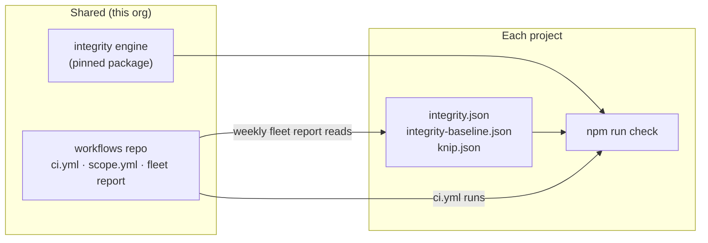

# Fleet Standards: Code Integrity and Monitoring — Design

**Date:** 2026-10-18
**Status:** Draft for review. Not built. The user's rulings of 2026-10-18 are in §11.
**Home:** `nothingfortune/workflows` (this repo), which owns shared CI.
**Sources:**
- [`2026-10-18-code-integrity-requirements.md`](2026-10-18-code-integrity-requirements.md),
  the user's requirements, kept verbatim and called **the requirements**
  below. Its FR, § and phase numbers are cited as they appear there.
- outerReach `docs/specs/2026-10-11-feature-map-design.md`, called
  **feature-map**.
- base `docs/guides/quality-gates.md`.
- The cross-repo survey of 2026-10-18.

## 1. Why

In the user's words: "it's a lot to keep in my head, I don't know what I
don't know", "always something I'm validating and revalidating", and "I'm
just trying to avoid keeping all the various workflows I've built, that are
not unique, in sync constantly … then I rely on them but forget I didn't
port that one workflow over".

The problem the survey found:

- Shared tooling is copied between repos and drifts. `pr-reviews-done.sh`
  exists in 4 repos as 4 different files, and `pre-push` in 5 repos as 4
  versions.
- A fix reaches base through a manual "template refresh" and never flows
  back out to the repos that already exist.

The shared CI workflows in this repo are the one part that already works:
callers pin a release and Dependabot bumps them.

**Success:** every project meets one standard without the user remembering
to port anything.

- A check is built once, here, and reaches every project as a pinned
  version that Dependabot bumps.
- Each project holds only what is unique to it: its config and its
  baseline.
- One report says, for the whole fleet, what is current, what is behind,
  what is missing and what could not be checked.

The user wants the full integrity build specified for the long term, so
"automatically monitor and maintain these many code bases to a consistent
standard" is the goal of this design.

## 2. Goals, non-goals, anti-goals

**Goals**

1. **Integrity checks.** Broken references, dead code, cycles and
   architecture boundaries, enforced the same way in every TypeScript
   project. Each finding comes with its evidence (the requirements, FR-001
   to FR-005, §§4–10).
2. **Delivery without copying.** Each project adopts or upgrades a check by
   changing a pin, never by pasting files.
3. **Fleet monitoring.** One scheduled report covers every repo: which
   shared pieces it uses, at which version, which it is missing, and how
   much baselined debt it carries.
4. **A clean start for new projects, a ratchet for old ones.** New repos
   start strict. Repos with existing findings adopt with a baseline that
   can only shrink.

**Non-goals**

- Local developer tools that are not CI: the PR review-loop scripts, the
  `pre-push` hook and preflight. They have the same drift problem but a
  different delivery path. Handle them separately, later.
- PHP and WordPress analysis. feature-map's PHP extractor will emit the
  same edge format (§6.3), so the rules here apply to PHP once it exists.
  This design builds none of it.
- Automatic fixes, deletions, or pull requests opened in consumer repos.
- A hosted service or SaaS.

**Anti-goals** (these count as failure even if the system works)

- **A gate people mute.** Low-confidence findings that block get the gate
  disabled rather than obeyed. jarvis recorded exactly this lesson about
  exported-but-only-used-in-file.
- **Uncertainty reported as clean.** That includes an analyzer crash
  passing, a dynamic import dropped without a word (knip 6 does this today,
  §4), and a fleet repo that could not be read being shown as fine.
- **Two engines for one job,** such as two boundary checkers or two
  baseline formats. feature-map already rejected dependency-cruiser for
  this reason.
- **A second copy problem,** where a check ships here but its scripts
  still have to be pasted into each repo.
- **CI rewriting a baseline.**

## 3. Principles

1. **Shared CI is called, never copied.** Projects hold config and
   baseline, nothing else.
2. **CI and local agree.** A project's local gate (`npm run check` in base)
   runs everything its CI runs. No check exists only in CI.
3. **Reuse analyzers; build only the layer they lack.** That means knip,
   `tsc`, and the TypeScript compiler API that feature-map also uses.
4. **Fail closed.** A crash, an unreadable baseline, invalid config or an
   unreadable fleet repo is a failure, reported with its own exit code or
   section, never as a pass.
5. **Identity, not counts.** A baselined or suppressed finding is matched
   by a fingerprint with no line numbers. A new finding fails even when
   the same change removes an old one (feature-map §6).
6. **Two-way ratchet.** A baseline entry or suppression that no longer
   matches anything also fails, so exceptions cannot pile up. This is the
   house posture of comment-density and jarvis's stale-allowlist test.

## 4. What already exists (2026-10-18)

| Requirement | Status | Where |
| --- | --- | --- |
| FR-001 broken imports, aliases, project references | Covered for TypeScript | `tsc --noEmit` and knip `unresolved` in base's `check` |
| FR-001 unlisted dependencies | Covered | knip `unlisted` |
| FR-001 configured manifest and asset paths | **Gap** | Nothing checks `package.json` script paths or local paths in workflows. fleetDemo G10 and outerReach #343 were this class. |
| FR-002 orphaned files | Covered | knip `files` |
| FR-002 disconnected (reachable only from tests) | Covered in base by PR base#27 | `knip --production` with `!` entries |
| FR-002 island vs orphan distinction | **Gap** | knip reports both as "unused file" |
| FR-003 unused exports, public API | Covered | knip `exports`; `@public-api` is already a house marker |
| FR-004 unused, unlisted, unresolved dependencies | Covered | knip |
| FR-005 production vs test reachability | Covered | the same `--production` pass |
| §4 dynamic references | **Gap** | knip silently skips a template-literal `import()`. It reports nothing, so the reference is invisible. |
| §5 cycles | Partly | knip 6 `cycles` reports the path; it is not enabled, not production-aware and has no policy |
| §6 boundaries | **Gap** | feature-map designs tiers and `depends_on`; nothing is built |
| §7 normalized findings with confidence | **Gap** | — |
| §8 baseline, §9 suppressions | **Gap** for findings | comment-density shows the house baseline pattern |
| §10 annotations, summary | Partly | knip `--reporter github-actions` (base#27); no summary, JSON or SARIF |
| §11 analysis failure distinct from findings | **Gap** | knip exits 1 for both |
| Fleet visibility | Started | `scripts/fleet-report.mjs` (PR #15) |
| Shared non-workflow CI logic | Started | `scope.yml` (PR #15) replaces copied doc-only scripts |

knip, `tsc` and base's existing gates already cover most of FR-001 to
FR-005. **The build is the layer they lack:** normalization, identity
baselines, suppressions, dynamic-reference visibility, the island
distinction, cycle and boundary policy, reports, and delivery and
monitoring across the fleet.

## 5. Architecture

### 5.1 Delivery: how the engine reaches a project

The engine is a substantial program: adapters, an extractor, baseline logic
and renderers. It has to run at the version the project pinned, and the
same way locally as in CI (principle 2).

**Ruled: a pinned package that the project's own `check` runs.**

- **How it ships:** a public git dependency pinned by commit SHA, with
  committed `dist/`. This is feature-map's ruling (its §11): Node will not
  strip TypeScript under `node_modules`, and a public repo is what lets the
  `hestiamediagroup` repos fetch it without a cross-org token.
- **How it runs:** the project adds `"integrity": "integrity check"` and
  puts it in `check`, in place of the bare `knip` script.
- **Why no new workflow:** the shared `ci.yml` already runs `check`, so no
  workflow changes at all.
- **How it updates:** Dependabot (npm ecosystem) bumps the pin. Step 0 of
  the plan must verify that Dependabot opens PRs for a SHA-pinned GitHub
  dependency. If it does not, pin to a semver tag ref (`#v1.2.0`) instead.

**Rejected: a reusable `integrity.yml` here that checks out its own
repo.**

- A reusable workflow cannot read its own ref from the `github` context,
  which always describes the caller. The only way to get it is the
  `job_workflow_sha` claim in an OIDC token, so every caller must grant
  `id-token: write` (toolkit issue #1264; the Nextstrain
  `workflow-context` action is the known workaround).
- It also breaks principle 2. Running the same version locally would need
  a second mechanism.

**Small logic stays inline in shared workflows,** the way `scope.yml`
does, with tests that extract and run the `run:` block
(`scripts/scope.test.mjs`).

**Where the package lives (ruled): in this repo.**

- npm installs a GitHub dependency from the repo root only, so the root
  `package.json` names the package and `files` limits it to `engine/`
  (source and committed `dist/`). Consumers install
  `github:nothingfortune/workflows#<sha>`.
- **One version stream.** `release.yml` releases when a callable workflow
  *or* `engine/**` changes. A consumer's workflow pins and engine pin
  then point at the same release, and the fleet report checks both
  against the same tags.
- **Accepted costs:**
  - Each release reaches each consumer as two Dependabot PRs (GitHub
    Actions and npm), even when only one side changed.
  - A breaking engine change is a major release for workflow callers too.
- `lint.yml` gains the engine's tests and a check that `dist/` matches a
  fresh build.
- feature-map's planned separate repo is superseded. Its core lives in
  `engine/` as well (§6.7).

### 5.2 Components

| Component | Responsibility | Built on |
| --- | --- | --- |
| knip adapter | Runs knip twice (default and `--production`) with the JSON reporter and maps every issue type to findings. The production pass is what distinguishes disconnected (test-only) code from orphaned code. | knip ≥ 6, the project's own `knip.json` |
| reference check (REF-003) | Paths named in `package.json` scripts, knip `entry`, and local `run:`/`uses: ./` paths in `.github/workflows` must exist | Node, the TS scanner for scripts |
| TS edge extractor | `ts.preProcessFile` plus `ts.resolveModuleName` per tsconfig, and an AST walk for `import()` / `require()` with a non-literal argument. Emits feature-map's `edges.json` format. | TypeScript compiler API; **shared with feature-map**, built once |
| graph rules | island vs orphan (inbound edges, no path from a production root); cycles with the full path and a production/test split; boundary rules | `edges.json` |
| findings core | schema, fingerprints, policy, baseline, suppressions, exit codes | — |
| renderers | stdout, `$GITHUB_STEP_SUMMARY` markdown, `::error`/`::warning` annotations, `build/integrity/report.json`, optional SARIF | — |
| `explain` | Why a file is classified as it is: inbound edges, reachability from each root, matching registrations and suppressions | the graph |

## 6. Behavior

### 6.1 Rules

| Rule | Finding | Default severity | Can be baselined |
| --- | --- | --- | --- |
| REF-001 | unresolved import or module | error | **never** |
| REF-002 | unlisted dependency | error | **never** |
| REF-003 | a manifest or workflow path that does not exist | error | **never** |
| DEAD-001 | orphaned file (no inbound edges) | warning | yes |
| DEAD-002 | unused export | warning | yes |
| DEAD-003 | unused dependency or devDependency | warning | yes |
| DEAD-004 | disconnected: reachable only from tests | warning | yes |
| DEAD-005 | island: has inbound edges, but no path from any root | warning | yes |
| DYN-001 | dynamic reference that cannot be resolved | info (review) | yes |
| CYC-001 | cycle in production code | warning | yes |
| CYC-002 | cycle that crosses a declared boundary | error | yes |
| ARCH-001 | boundary rule violation | per rule | yes |
| CFG-001 | invalid config, expired or stale suppression, stale baseline entry | error | **never** |

**Severity and enforcement:**

- Enforcement is by severity alone. `confidence` is reported and shown
  in the summary but never decides what blocks. A rule whose findings can
  be low-confidence therefore defaults to `info` (requirements §16: never
  block on low confidence alone). DEAD-005 and `declared-load` findings
  are medium, and DYN-001 is low.
- Warnings fail the gate in enforce mode unless baselined or suppressed.
  base already runs knip with zero tolerance, and the rule names keep
  severity visible.
- Info never fails. DYN-001 is info because a dynamic reference is
  uncertainty, not a defect (requirements §2.4), but it is always listed
  so it cannot hide.

### 6.2 Findings and fingerprints

Findings follow the requirements' §7 schema: `ruleId`, `severity`,
`confidence`, `classification`, `file`, `line`, `symbol`, `message`,
`evidence[]`, `remediation`, `analyzer`. Each also carries `fingerprint`,
`engineVersion` and `analyzerVersion`.

**The fingerprint is** `sha256(ruleId | normalized path | symbol or
specifier | normalized expression)`.

- The normalized path is POSIX, relative to the repo root.
- The expression is whitespace-collapsed, and used only for DYN and CYC.
- A cycle's identity is its member paths, rotated so the
  lexicographically smallest path comes first.
- For DYN-001, the symbol slot holds the enclosing function. That makes
  the identity feature-map's unresolved-edge identity: file, edge kind,
  enclosing function, normalized expression.
- **There are no line numbers**, so an unrelated edit does not change a
  fingerprint (feature-map §6).

### 6.3 Dynamic references (requirements §4)

The four layers of requirements §4 map like this:

- **Layer 1, static analysis:** the extractor and knip.
- **Layer 2, framework conventions:** knip's plugins, such as vitest,
  eslint and next.
- **Layer 3, explicit registrations:** in `integrity.json` →
  `loaders[]`, each entry names a loader file and target globs. Each match
  becomes an edge of kind `declared-load` with confidence medium, so its
  targets are reachable but labeled as declared, not proven. These are not
  called "registrations", because feature-map uses that word for
  REST/menu/CLI identities that never decide reachability or boundaries.
- **Layer 4, unknown:** every unresolved dynamic reference is a DYN-001
  finding, listed in every run.

A broad glob never makes files reachable silently. Every registration is
printed in the report.

The edge format is feature-map's: source, target, kind, line, resolved. A
PHP extractor written later plugs into the same graph rules.

### 6.4 Modes, baseline and suppressions

**Modes** (in `integrity.json`):

- `enforce` (the default): findings not in the baseline and not
  suppressed fail.
- `observe`: findings print and the exit code is 0.

Analysis failure and invalid config fail in both modes. Strict and ratchet
are not separate modes: an empty baseline *is* strict.

**Baseline** (`integrity-baseline.json`, at the repo root next to
`comment-density-baseline.json`):

- It holds `{ schemaVersion, engineVersion, entries: [{ fingerprint,
  ruleId, file, symbol }] }`.
- It is written only by `integrity baseline` run locally. CI never writes
  it.
- A new fingerprint fails. So does an entry that no longer matches
  (CFG-001, stale). The PR that fixes a finding removes its entry.
- An unreadable baseline fails closed.

**Suppressions** (`integrity.json` → `suppressions[]`):

- Each holds `{ rule, target, reason, owner, expires }`. `target` is a
  path, a `path#symbol`, or a fingerprint.
- `expires` is a date. It may be omitted only with `"permanent": true`
  plus a reason (requirements §9).
- An expired suppression fails, and so does one that matches nothing.
- The difference from the baseline: **a baseline is debt to burn down,
  and a suppression is a justified decision.**
- REF findings cannot be baselined, but they can be suppressed, so a
  misfiring REF-003 path match has an outlet short of turning the gate
  off. CFG-001 can be neither.

The `@public-api` JSDoc marker keeps working for exports, through knip's
`--tags`.

### 6.5 Exit codes and outputs

**Exit codes:**

- 0: pass, or observe mode.
- 1: blocking findings.
- 2: analysis failure, invalid config, or an unreadable baseline.

**Every run:**

- Prints a summary in the shape of requirements §10: counts per rule, new,
  baselined, suppressed, stale, and the analysis limitations (DYN count,
  registrations used).
- Writes `build/integrity/report.json`.
- In GitHub Actions, also appends the summary to `$GITHUB_STEP_SUMMARY`
  and emits one annotation per new finding.

`--sarif <path>` is opt-in, for public repos where GitHub code scanning is
free (base and workflows; dollyVision is private). Uploading it takes a
caller job with `security-events: write`. That is documented, not
defaulted, because shared `ci.yml` stays `contents: read`.

### 6.6 Boundaries (requirements §6)

**Two forms, both evaluated on `edges.json`:**

- **Glob rules** in `integrity.json` → `boundaries[]`: `{ id, from,
  disallow[], severity }`. They cover package encapsulation, layering
  direction and legacy isolation.
- **Feature tiers and `depends_on`,** read from a project's
  `features.json` when feature-map is adopted. `platform` must not depend
  on a feature. An undeclared feature dependency fails (feature-map §7).

The same graph rules evaluate both. There is no second rule engine.

### 6.7 Relationship to feature-map

There is one core. The edge format, the graph rules, the baseline and the
findings layer specified here *are* the core that feature-map §11 calls for.
They are built once, in this repo's `engine/` (§5.1).

- **Edges.** The shared core owns the `edges.json` schema. This design
  uses feature-map's fields (source, target, kind, line, resolved) and
  adds only the `declared-load` kind.
- **Baseline.** There is one file per repo, `integrity-baseline.json`. It
  replaces feature-map's planned `features.baseline.json`. Feature-map's
  boundary violations and unresolved edges become ARCH and DYN findings in
  it.
- **Cycles.** feature-map's "any cycle fails" is outerReach's
  configuration: CYC-001 is set to `error` there. Existing cycles are
  baselined, exactly as feature-map §7 bootstraps its violations.
- **outerReach's boundary gate (feature-map gate J)** is implemented by
  this engine's ARCH rules over the PHP extractor's edges once that
  extractor exists. Neither repo gets a second boundary checker.
- **Status, 2026-10-18:** no feature-map core work has started
  (`nothingfortune/feature-map` does not exist). I3 builds the TS
  extractor in the form feature-map needs. outerReach adopts through
  feature-map's own PR sequence and is not an adopter in this plan.

## 7. Fleet monitoring

**Built (PR #15):** `node scripts/fleet-report.mjs` uses the user's `gh`
login. It lists each repo's calls to shared workflows, each pin's status
(current, behind by N, unpinned, unreleased), same-named local files that
never call the shared workflow, and repos that call nothing.

**Still to build:**

1. **`fleet.json` in this repo.** For each repo it declares a profile
   (`ts-app`, `wordpress`, `ts-tool`, `none`) and any exceptions. Each
   profile lists the shared pieces it expects: workflows, the engine, and
   files such as `knip.json`. That turns "possible copy" guesses into
   exact "missing" findings.
   - A repo absent from `fleet.json` is reported as **unclassified**,
     never skipped.
   - The first version is drafted by `fleet-report --propose` and
     reviewed by hand once.
2. **More facts read per repo** (through the API, read-only):
   - the engine pin in `package.json`, and its status against engine
     releases;
   - baseline size per rule from `integrity-baseline.json`, compared with
     the previous report, so debt burn-down is visible;
   - whether branch protection requires the shared checks. base's
     `setup-github.sh` defines the expected rules.
3. **A weekly scheduled run here.**
   - It authenticates as a GitHub App, installed read-only on
     `nothingfortune` and `hestiamediagroup` (repository contents and
     metadata, plus administration read for branch protection). The
     default token cannot read private repos in another org.
   - It writes the report to the step summary and updates **one** tracking
     issue in this repo, edited in place, never a new one each week.
   - It never writes to consumer repos.
   - A repo it cannot read is its own section, never omitted.

**Maintenance stays human-approved.** Upgrades arrive as Dependabot PRs in
each repo, and the report shows which repos are behind or missing pieces.
Opening adoption PRs automatically is out of scope (§2).

## 8. Phases

Each phase ships on its own and has acceptance criteria. I-phases are the
integrity engine, F-phases fleet monitoring.

**I0 — Package and delivery spike.**
- Add `engine/` and the root `package.json` to this repo, with a `check`
  CLI that wraps knip's two passes and exits 0, 1 or 2.
- Extend `next-version.mjs` and its tests so `engine/**` changes release.
- Install it in base by SHA.
- Accept when:
  - base's `check` runs it;
  - a forced knip crash exits 2;
  - a Dependabot PR for a new engine SHA appears in base, or the tag-ref
    fallback is adopted and documented.

**I1 — Reference integrity and reports.**
- knip adapter for every issue type, REF-003, findings and fingerprints,
  all renderers, observe and enforce modes.
- base replaces its `knip` script.
- Accept when:
  - each of these planted defects produces exactly one finding with a
    stable fingerprint: a missing import, an unlisted dependency, an
    unused export, an orphan, a test-only module, a `package.json` script
    pointing at a missing file, and a workflow `run:` path to a missing
    script;
  - an unrelated edit above a finding does not change its fingerprint;
  - the summary appears in the step summary and `report.json` validates
    against its schema.

**I2 — Baseline and suppressions; first adopter with existing debt.**
- Accept when:
  - in base's fixtures, a new finding fails, a stale baseline entry
    fails, and an expired or unmatched suppression fails;
  - a REF finding cannot be baselined;
  - dollyVision adopts in enforce mode with a generated baseline. It has
    no knip today and its plan calls for scoped ignores, so it is the
    real-debt test case.

**I3 — Graph: dynamic references, islands, cycles, `explain`.**
- Build the TS extractor once, in the form feature-map needs.
- Accept when:
  - a template-literal `import()` yields DYN-001;
  - a declared registration makes its targets reachable and labels them
    declared;
  - two files importing only each other yield DEAD-005, not DEAD-001;
  - a cycle's fingerprint is stable under rotation;
  - `integrity explain <file>` prints its inbound edges and root
    reachability.

**I4 — Boundaries and SARIF.**
- Accept when:
  - a planted import into another package's `internal/` fails its glob
    rule;
  - with a `features.json`, a platform→feature edge fails;
  - `--sarif` output uploads cleanly in base's public repo.

**A — Fleet adoption** (after I2; one small PR per repo).

Covers every active TypeScript repo. In order of recent activity:
dollyVision (in I2), sawdustAtlas, meridianCore, azeronMappings,
silentCartographer, sovereignWard, then the `ur-cdt` repos atlasAdmin and
jarvis-ur-ops-automation.
- **Exclusions:**
  - outerReach adopts through feature-map's PR sequence (§6.7).
  - fleetDemo follows outerReach, because it is a copy of it.
  - JarvisAutomation is superseded by jarvis-ur-ops-automation.
- **Each adoption PR:**
  - adds or adjusts `knip.json` with `!` production entries;
  - adds `integrity.json`;
  - commits a generated baseline;
  - wires `integrity check` into the repo's gate. Most of these repos
    have no `check` script: jarvis uses `validate`, and several run their
    own CI steps. The integrity script goes into whatever single command
    the repo's CI runs, and where there is none, the PR creates `check`.
- Its `fleet.json` profile is updated in the same week.
- **Accept when:** the fleet report shows the repo's engine pin as
  current and its baseline size.
- **Access caveat:** the `ur-cdt` repos are not visible to the user's
  current `gh` login (2026-10-18). Until that is fixed, the fleet report
  cannot read them and the F3 App needs installing there too.

**F1 — Fleet profiles** (`fleet.json`, `--propose`, exact "missing",
unclassified repos).
- Accept when: removing a declared shared workflow from a test fixture
  repo reports it missing.

**F2 — More facts** (engine pin, baseline trend, branch protection).
- Accept when: a fixture baseline that grew is flagged with the per-rule
  delta.

**F3 — Weekly run and tracking issue.**
- Accept when:
  - two consecutive runs edit the same issue;
  - a repo the App cannot read appears under "not read";
  - the run fails if the App token is missing.

**Suggested order:** I0, I1, F1, I2, A, I3, F2, F3, I4. F1 comes early
because "forgot to port it" is the stated pain, and exact "missing"
findings answer it.

## 9. Constraints

- Node ≥ 22. The engine's only runtime dependencies are `typescript` and
  `knip`. Both are the consuming project's own peer dependencies, so the
  versions match what its `check` already uses.
- Source files stay under 400 lines and functions under 150 (base's
  monolith limits).
- One-line WHY comments; extended rationale goes in docs.
- **Every rule has a planted-defect test and a clean control.** This
  includes everything in requirements §14, plus Windows-vs-POSIX paths,
  renames, `package.json` `exports`, and deterministic fingerprints.
- **Security:**
  - The engine never executes analyzed code. knip loads a project's tool
    configs to run its plugins, which is the same trust the project's own
    `check` already extends.
  - CI stays `contents: read`. The fleet App is read-only.
  - Actions and the engine are SHA-pinned.
- **Performance:** a full run should take under 3 minutes on a
  template-derived repo, excluding install (requirements §15). The report
  prints its own duration.

## 10. Left to the builder

- Exact JSON schemas, CLI flag names and summary layout, within §6.
- How the knip adapter maps each knip issue type to rules, provided every
  type maps to some rule and none is dropped. An unknown knip issue type
  exits 2.
- The internal module layout of the engine and of the fleet report.
- Fixture design.

## 11. Decisions

**Ruled by the user, 2026-10-18:**

1. **Delivery:** a pinned package run by each project's `check` (§5.1).
2. **Engine home:** inside this repo. The user prefers fewer repos; the
   costs are recorded in §5.1.
3. **Warnings block by default** (§6.1). Older repos adopt with a
   baseline that can only shrink.
4. **Adoption:** every active TypeScript repo (§8, phase A).

**Still open:**

- **The fleet GitHub App for F3.** It must be created by an admin of
  `nothingfortune`, `hestiamediagroup` and `ur-cdt` and installed
  read-only on all three. If administration read is refused anywhere, F2
  reports branch protection for that org under "not read".

**Calls made here, for the user to check:**

- Stale baseline entries and stale suppressions fail rather than warn
  (principle 6, house posture).
- Expiry dates are mandatory for suppressions unless they are marked
  permanent.
- Config is JSON at the repo root rather than YAML under `.config/`.
  That avoids a YAML dependency and matches `knip.json` and
  `comment-density-baseline.json`.
- No separate `code-integrity.yml` workflow. It runs inside `check`
  (principle 2).
- SARIF is opt-in, because the shared `ci.yml` keeps least privilege.
